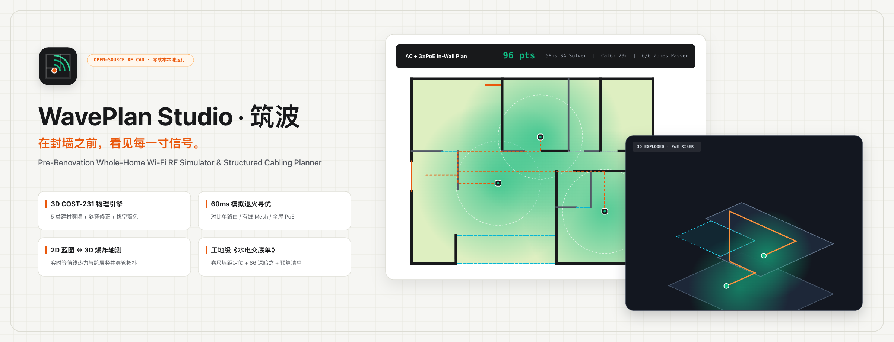
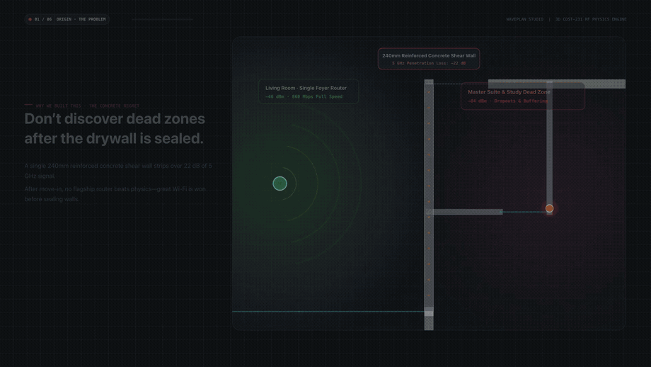
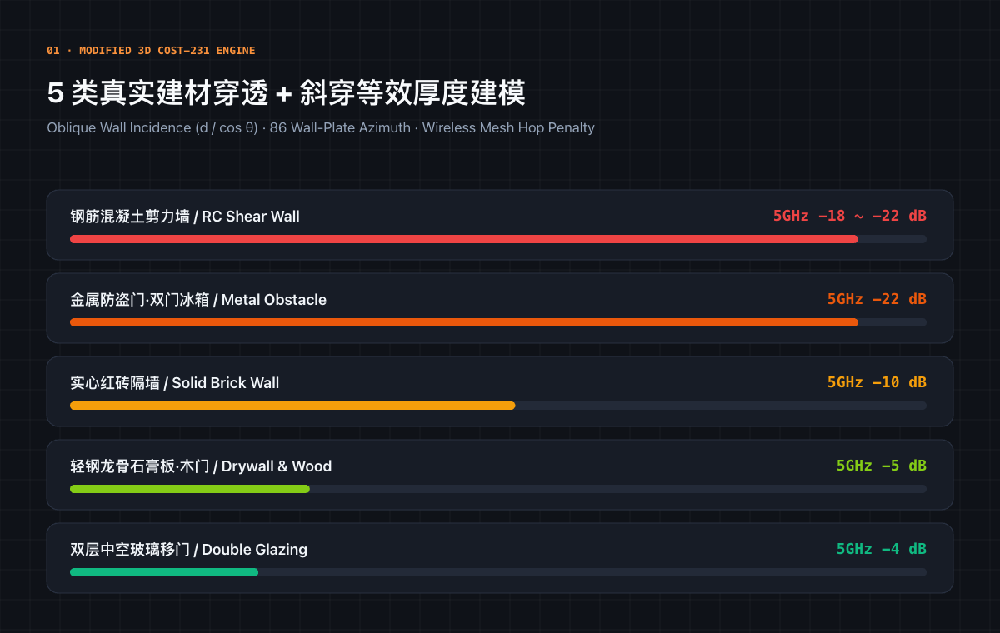
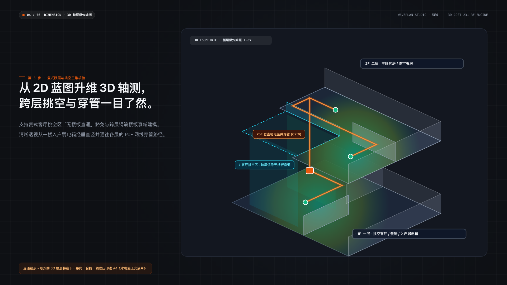
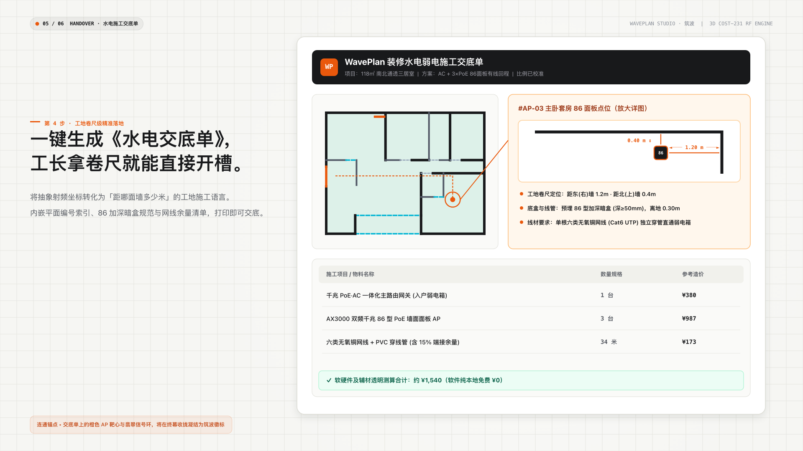

<div align="center">



<br />

[](https://amazingjie666.github.io/waveplan-studio/)
[](https://github.com/AmazingJie666/waveplan-studio)
[](./package.json)
[](./LICENSE)

<h3>在封墙之前，看见每一寸信号。<br/><sub>See Every Decibel Before Sealing the Walls.</sub></h3>

<p align="center">
  <b>装修前全屋 WiFi 射频物理仿真与水电弱电布线规划工具</b><br/>
  <sub>Pre-Renovation Whole-Home Wi-Fi RF Simulator & Structured Cabling Planner</sub>
</p>

</div>

---

## 为什么做「筑波 WavePlan Studio」？ / Why WavePlan?

绝大多数家庭都是在**水电封槽、瓷砖贴好、家具进场之后**，才发现主卧和书房隔着钢筋混凝土剪力墙，`5 GHz` 高频信号断崖式跌破 `-80 dBm`。入住之后，再昂贵的旗舰路由器也无法违背物理衰减定律，而拉明线又会破坏精心设计的极简家装。

**全屋好网络真正的决胜时刻不在入住后，而在水电开槽封墙之前。**  
`WavePlan Studio · 筑波` 让你无需掌握晦涩的射频工程公式，也不用把私密户型图上传到任何云端服务器——在水电交底前 **3 分钟**，算清「设备放哪最稳、六类网线往哪埋」，直接打印一张工长拿卷尺就能精准施工的《水电施工交底单》。

> Most homeowners only discover Wi-Fi dead zones *after* the drywall is sealed. One 240mm reinforced concrete shear wall strips over `20 dB` of `5 GHz` signal. **WavePlan Studio** runs 100% locally in your browser so you can simulate multi-floor RF physics, auto-solve optimal AP coordinates in `60ms`, and print a tape-measure-ready **Structured Cabling Handover Sheet** for your electrician before renovation begins.

<div align="center">
  
  <p>
    🎬 <b>1080p 60fps 有声宣传片（带自然旁白解说）</b>：
    <a href="./promo/waveplan_promo_zh.mp4">中文版宣传片 (MP4)</a> ·
    <a href="./promo/waveplan_promo_en.mp4">English Promo Film (MP4)</a>
  </p>
</div>

---

## 核心特性矩阵 / Core Capabilities

<table>
  <tr>
    <td width="50%" valign="top">
      
      <h4>1. 修正版 3D 跨层物理衰减引擎 (Modified 3D COST-231)</h4>
      <p>内置 5 类真实装修遮挡建模（钢筋混凝土承重墙、实心红砖墙、轻钢龙骨石膏板/木门、双层中空玻璃、金属防盗门/双门冰箱），完整纳入<b>斜穿墙等效厚度修正 (<code>d / cos θ</code>)</b>、<b>86 面板定向辐射方向图</b>、<b>无线 Mesh 回程损耗惩罚</b>及<b>复式挑空区无楼板穿透豁免</b>。</p>
    </td>
    <td width="50%" valign="top">
      
      <h4>2. 60ms 双模式模拟退火寻优 (Web Worker Solver)</h4>
      <p>独立 Web Worker 异步求解，不阻塞 60fps 交互界面：<br/>• <b>按需推荐组网架构</b>：同屏横评「单台旗舰路由 / 有线回程 Mesh / 全屋 AC+PoE 隐形面板」的综合分、达标率、网线米数与硬件预算。<br/>• <b>指定设备求最优位</b>：通过贪心初始化 + 模拟退火自动避开厨卫湿区与挑空区，求解全局最高分摆法。</p>
    </td>
  </tr>
  <tr>
    <td width="50%" valign="top">
      
      <h4>3. 2D 建筑蓝图 ↔ 3D 多层爆炸轴测透视</h4>
      <p>2D 蓝图支持 60fps 拖拽实时热力刷新、Marching Squares 信号等值线（<code>-58 / -67 / -75 dBm</code>）、正交磁吸画墙与悬停速率探针；一键切换 Three.js <b>3D 多层悬浮爆炸视角</b>，直观核验楼板真开洞挑空区与跨层垂直弱电竖井的 Cat6 PoE 穿管路径。</p>
    </td>
    <td width="50%" valign="top">
      
      <h4>4. 纯本地户型提取 & 工地级《水电施工交底单》</h4>
      <p>零后端、零 API 费用，上传开发商户型图即可在浏览器本地提取墙体草稿；一键导出可打印 A4 PDF <b>《水电施工交底单》</b>，将抽象坐标转化为电工师傅熟悉的<b>「距哪面墙多少米」卷尺定位语言</b>，附带 86 加深暗盒规范与 <code>+15%</code> 网线余量测算。</p>
    </td>
  </tr>
</table>

---

## 30 秒快速上手 / 3-Step Quick Workflow

| 步骤 / Step | 操作说明 / Action | 关键避坑提示 / Pro Tip |
| :--- | :--- | :--- |
| **Step 01 · 选户型与校准比例**<br/>`Import & Calibrate Scale` | 直接选择内置 3 套典型样板间（`118㎡ 平层三居` / `165㎡ 挑空复式` / `260㎡ 三层联排`），或点击 **上传户型图** 自动提取墙体。 | 导入自定义图纸后，务必使用左侧 **比例尺 (`Scale`)** 沿着已知开间拉一条基准线并输入真实米数，确保穿墙衰减与网线米数 100% 精准。 |
| **Step 02 · 定弱电箱与标需求点**<br/>`Set Weak Box & Demand Pins` | 用 **定弱电箱 (`Weak Box`)** 标出入户光纤光猫位置，再用 **标需求点 (`Demand Pin`)** 点出书房电竞桌、主卧床头、客厅沙发等重点角落。 | 不同需求点拥有不同目标阈值（如极高优电竞/会议要求 `5 GHz ≥ -60 dBm`），求解器会优先保障高权重区域满格。 |
| **Step 03 · 一键寻优与打印交底**<br/>`Auto-Optimize & Print Sheet` | 点击右侧 **一键计算全屋最优组网方案**，对比并应用最佳方案；核验无误后点击右上角 **水电交底单 (`Wiring Sheet`)** 直接打印或存为 PDF 发给工长。 | 支持 `中文 / English` 双语切换、`Auto / 明亮 / 暗黑` 仪器主题、`.waveplan.json` 工程文件导入导出及 `Ctrl/Cmd + Z` 多步撤销。 |

---

## 本地运行与构建 / Local Development

环境要求：`Node.js >= 20`

```bash
# 1. 克隆仓库 / Clone repository
git clone https://github.com/AmazingJie666/waveplan-studio.git
cd waveplan-studio

# 2. 安装依赖 / Install dependencies
npm install

# 3. 启动本地开发服务器 / Start dev server
npm run dev

# 4. 构建生产版本 / Build static bundle
npm run build
```

---

## 技术架构速览 / Architecture

```text
waveplan-studio/
├── src/
│   ├── engine/
│   │   ├── rfModel.ts          # 修正版 3D COST-231 物理衰减、斜穿墙修正、挑空豁免与 Mesh 惩罚
│   │   ├── heatmap.ts          # 高分辨率信号网格计算、Marching Squares 等值线与全屋评分引擎
│   │   ├── optimizer.ts        # 贪心初始化 + 全局模拟退火 (Simulated Annealing) 组网求解算法
│   │   ├── optimizer.worker.ts # 独立 Web Worker 异步寻优线程 (~60ms)
│   │   ├── geometry.ts         # 正交曼哈顿 Cat6 走线估算、房间感知与工地卷尺墙距定位解算
│   │   └── imageExtractor.ts   # 纯前端 Canvas 户型底图二值化与正交墙段提取
│   ├── components/             # 2D 蓝图画布、Three.js 3D 爆炸视图、A4 水电交底单与交互面板
│   ├── presets/                # 118㎡ 平层 / 165㎡ 挑空复式 / 260㎡ 三层联排建筑级预设
│   └── i18n/                   # 完整中英双语词典与自适应暗黑/明亮主题状态
├── docs/assets/                # 仓库架构图卡与动图演示资产
└── promo/                      # 中英双版本 1080p 60fps 有声宣传片
```

---

## 共创者与开源协议 / Co-Creators & License

- **Ajie** ([@AmazingJie666](https://github.com/AmazingJie666)) — Product Vision, Architectural Scenarios & Requirements
- **Antigravity** — Co-Creator, RF Physics Engine & UI/Motion Implementation

Released under the [MIT License](./LICENSE).
